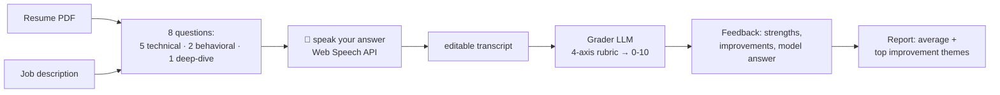

# Interview Copilot — Voice Interview Prep (Web Speech API + LLM grading)

**The self-referential one interviewers love.** Upload your resume + paste the job description → get the 8 questions you're most likely to be asked → answer **out loud** (browser speech-to-text, zero cost) → each answer is graded on a 4-axis rubric with strengths, improvements and a model answer → final report with your average and top improvement themes.

## Why this design

- **Web Speech API** for STT: no Whisper GPU, no API cost, works in Chrome/Edge with a fallback to typing. (Roadmap: faster-whisper for privacy + more browsers.)
- **Resume-grounded grading**: the grader sees the resume and JD, so "use specifics from your actual projects" is enforceable, not aspirational.
- **Fixed rubric** (`evals/rubric.md`): correctness 40% · resume evidence 25% · structure 20% · communication 15% — the same weights are in the prompt and the doc, so scores are consistent.

## Flow



## Run it

```bash
python -m venv .venv
.venv/Scripts/pip install -r requirements.txt
cp .env.example .env                        # set OPENAI_API_KEY
.venv/Scripts/python -m uvicorn app.main:app --reload
# open http://localhost:8000 in Chrome/Edge (allow mic access)
```

## Resume bullet

> Built a voice interview-prep copilot (Web Speech API + LLM grading) that scores spoken answers against a 4-axis rubric and generates a per-session improvement report; X mock interviews run during my own job hunt.

## Roadmap

- [ ] Auth + session history in Postgres
- [ ] RAG over your resume (pgvector) for deeper project questions — reuses DocuMind components
- [ ] faster-whisper STT + TTS playback of questions (full voice loop)
- [ ] Export report as PDF
